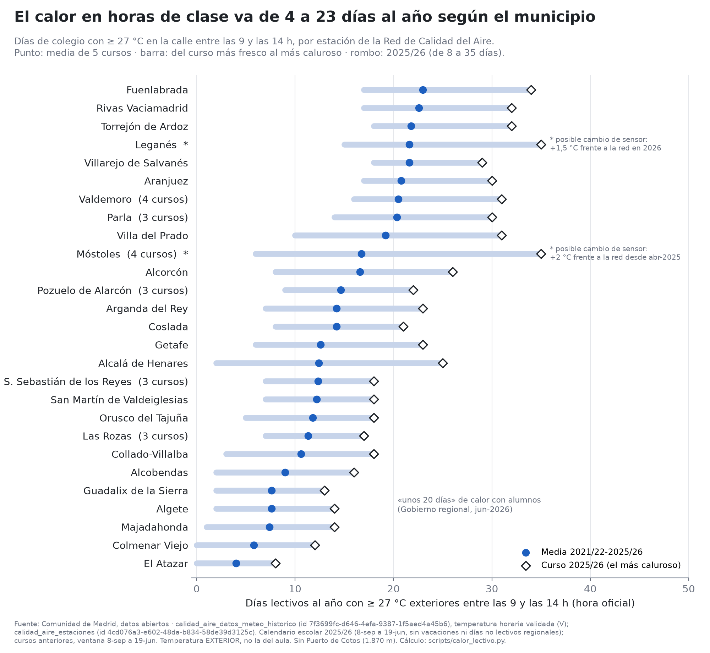

# Termómetro Escolar

**Cuántas horas de clase pasa cada colegio público de Madrid con calor, para decidir cuál se climatiza primero.**

Proyecto para [DATAMAD 2026](https://datos.comunidad.madrid), el hackathon de datos abiertos de la Comunidad de Madrid.



## El hallazgo

Los días de colegio con 27 °C o más en la calle entre las 9 y las 14 h van de **4 al año en El Atazar a 23 en Fuenlabrada**. Son medias de los cursos 2021/22 a 2025/26. En el curso 2025/26, el más caluroso, fueron de 8 a 35 días.

El orden entre municipios se mantiene de un curso a otro: la correlación de Spearman entre cursos consecutivos va de 0,80 a 0,95 ([`resultados/robustez.txt`](resultados/robustez.txt)). Por eso se puede usar para decidir.

## Para qué sirve

La Comunidad ha anunciado un plan de climatización de 840 M€. El plan prioriza los institutos y las escuelas infantiles construidos antes de 2006. Para los colegios municipales hay además 370 M€ del Programa de Inversión Regional (PIR). Termómetro Escolar añade un segundo criterio, **cuánto calor pasa cada centro en horario de clase**:

| Para quién | Qué le da |
|---|---|
| Consejería | Un orden de los 2.100 centros públicos por horas de calor con alumnos, para cruzarlo con la antigüedad del edificio. |
| Ayuntamientos | Qué colegios de su municipio presentar primero al PIR. |
| Familias y AMPA | En qué tramo está su colegio, con un dato oficial y abierto. |

## Cómo se calcula

1. **Temperatura en horas de clase.** Se usa la temperatura horaria validada de la Red de Calidad del Aire (28 estaciones). Se cuentan solo los días lectivos y las horas de 9 a 14 h, en hora oficial. El fichero viene en hora fija: se comprobó con el pico de radiación solar ([`scripts/hora.py`](scripts/hora.py)).
2. **De la estación al centro.** La temperatura de cada estación se interpola a las coordenadas de cada centro (inverso de la distancia y corrección por altitud). Se validó quitando una estación cada vez y prediciéndola con las demás. El error es de **1,5 °C** de media (RMSE), frente a 2,3 °C si se toma la estación más cercana ([`resultados/interpolacion.txt`](resultados/interpolacion.txt)).
3. **Resultado en tramos, no en puestos exactos.** Con ese error, decir que un colegio es el 312 y otro el 313 no tiene sentido. Cada centro se colocará en un tramo (por ejemplo, el 20 % con más calor), y para ordenar se usarán grados-hora por encima de 25 °C, menos sensibles que un umbral fijo a un error de 1-2 °C.

El umbral de 27 °C es una elección de este análisis para contar días de forma legible. No viene de ninguna norma.

## Estado (20-nov-2026)

- [x] Días y horas lectivas de calor por estación y curso, 2020/21 a 2025/26
- [x] Validación de la interpolación a cada centro y recuento de centros públicos en alta (2.100)
- [x] Comprobación de estabilidad entre cursos y de posibles cambios de sensor
- [ ] Orden de los 2.100 centros por tramos de calor, con alumnos estimados por municipio y etapa (Estadísticas de alumnos)
- [ ] Página «busca tu cole»: mapa con el tramo de cada centro

## Lo que este análisis no dice

- **Es temperatura exterior, no la del aula.** Sirve para decidir dónde medir y actuar primero, no para afirmar a cuántos grados está una clase.
- **Madrid capital no tiene ninguna estación de esta red dentro.** Sus 660 centros públicos con coordenadas quedan a una media de 7 km de la más cercana. Saldrán marcados como de confianza baja hasta añadir otra fuente.
- **Alumnos por centro:** el portal no los publica por centro. Se estiman a partir de la matrícula por municipio y etapa, y así se indicará.
- **Dos estaciones con posible cambio de sensor** (Móstoles, desde abril de 2025, y Leganés, en 2026) se calientan 1,5-2 °C respecto al resto de la red. Están marcadas en la figura. Por eso se usan medias de cinco cursos.
- Se excluye Puerto de Cotos (1.870 m), sin ningún centro cerca.

## Datos

Todos del [Portal de Datos Abiertos de la Comunidad de Madrid](https://datos.comunidad.madrid):

- [Red de Calidad del Aire. Datos meteorológicos horarios desde 2020](https://datos.comunidad.madrid/dataset/calidad_aire_datos_meteo_historico) (`calidad_aire_datos_meteo_historico`)
- [Estaciones de la Red de Calidad del Aire](https://datos.comunidad.madrid/dataset/calidad_aire_estaciones) (`calidad_aire_estaciones`)
- [Centros educativos de la Comunidad de Madrid](https://datos.comunidad.madrid/dataset/centros_educativos) (`centros_educativos`)
- [Estadísticas de alumnos de centros educativos](https://datos.comunidad.madrid/dataset/spacm_estadisticas_alumnos) (`spacm_estadisticas_alumnos`), para la estimación de alumnos

Calendario escolar 2025/26: del 8-sep-2025 al 19-jun-2026, sin vacaciones ni días no lectivos regionales. Para los cursos anteriores, del 8-sep al 19-jun, sin Navidad.

## Reproducirlo

Python 3.11. Los datos brutos (unos 80 MB) no están en el repositorio: se bajan del portal.

```bash
pip install -r requirements.txt
python -I scripts/descargar.py
python -I scripts/calor_lectivo.py datos/meteo datos/estaciones/calidad_aire_estaciones.csv resultados/calor_lectivo.csv
python -I scripts/robustez.py resultados/calor_lectivo.csv datos/meteo
python -I scripts/figura.py resultados/calor_lectivo.csv resultados/calor_en_clase.png
python -I scripts/interpolacion.py datos/meteo datos/estaciones/calidad_aire_estaciones.csv datos/centros/centros_educativos.csv
```

Las salidas de cada script están en [`resultados/`](resultados/).

## Autoría y licencia

Jorge Asenjo, para DATAMAD 2026. Desarrollado entre el 7 y el 26 de noviembre de 2026.

Código con licencia [MIT](LICENSE). Figura y resultados, [CC BY 4.0](https://creativecommons.org/licenses/by/4.0/deed.es). Los datos de origen son de la Comunidad de Madrid y mantienen su licencia.
