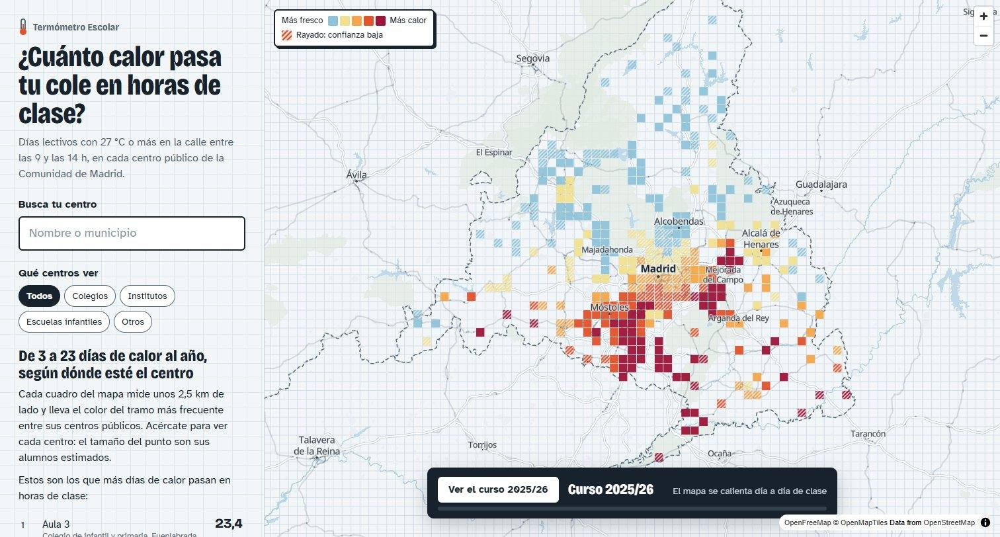

# Termómetro Escolar

**Cuántas horas de clase pasa cada colegio público de Madrid con calor, para decidir cuál se climatiza primero.**

Proyecto para [DATAMAD 2026](https://datos.comunidad.madrid), el hackathon de datos abiertos de la Comunidad de Madrid.

### [Busca tu centro en el mapa →](https://jorge-asenjo.github.io/termometro-escolar/)

[](https://jorge-asenjo.github.io/termometro-escolar/)

El mapa es una hoja cuadriculada. Cada cuadro mide unos 2,5 km de lado y lleva el color del tramo de calor más frecuente entre sus centros; va rayado donde la confianza es baja. Al acercarte aparecen uno a uno los 2.078 centros públicos en alta con coordenadas. Puedes buscar tu centro, ver en qué tramo de calor está frente al resto y reproducir el curso 2025/26 día a día.

## El hallazgo

Los días de colegio con 27 °C o más en la calle entre las 9 y las 14 h van de **4 al año en El Atazar a 23 en Fuenlabrada**. Son medias de los cursos 2021/22 a 2025/26. En el curso 2025/26, el más caluroso, fueron de 8 a 35 días.


El orden entre municipios se mantiene de un curso a otro: la correlación de Spearman entre cursos consecutivos va de 0,80 a 0,95 ([`resultados/robustez.txt`](resultados/robustez.txt)). Por eso se puede usar para decidir.

## Para qué sirve

La Comunidad ha anunciado un plan de climatización de 840 M€. El plan prioriza los institutos y las escuelas infantiles construidos antes de 2006. Para los colegios municipales hay además 370 M€ del Programa de Inversión Regional (PIR). Termómetro Escolar añade un segundo criterio, **cuánto calor pasa cada centro en horario de clase**:

| Para quién | Qué le da |
|---|---|
| Consejería | Los centros públicos ordenados por calor en horas de clase y por alumnos, para cruzarlo con la antigüedad del edificio. |
| Ayuntamientos | Qué colegios de su municipio presentar primero al PIR. |
| Familias y AMPA | En qué tramo está su colegio, con un dato oficial y abierto. |

En el 20 % de centros con más calor estudian unos **153.000 alumnos** (estimación, ver abajo).

## Cómo se calcula

1. **Temperatura en horas de clase.** Se usa la temperatura horaria validada de la Red de Calidad del Aire (28 estaciones). Se cuentan solo los días lectivos y las horas de 9 a 14 h, en hora oficial. El fichero viene en hora fija: se comprobó con el pico de radiación solar ([`scripts/hora.py`](scripts/hora.py)).
2. **De la estación al centro.** La temperatura de cada estación se lleva a cada centro con el inverso de la distancia y una corrección por altitud (−0,65 °C cada 100 m). La altitud de estaciones y centros sale del mismo modelo de terreno (Copernicus DEM, 90 m).
3. **Validación.** Se quita cada estación y se predice con las demás. El error es de **1,5 °C** (RMSE de todas las horas lectivas de cinco cursos) y la mediana por estación, de 1,3 °C ([`resultados/centros.txt`](resultados/centros.txt)). Si se toma sin más la estación más cercana, el error sube a 2,3 °C ([`resultados/interpolacion.txt`](resultados/interpolacion.txt)).
4. **Resultado en tramos, no en puestos exactos.** Con ese error, decir que un centro es el 312 y otro el 313 no tiene sentido. Cada centro va a un quintil según sus grados-hora por encima de 25 °C, menos sensibles a un error de 1-2 °C que contar días por encima de un umbral fijo.
5. **Alumnos.** El portal no publica alumnos por centro. Se reparte la matrícula de centros públicos del curso 2024/25 de cada municipio (de cada distrito, en Madrid capital) y etapa entre los centros que imparten esa etapa. Es una estimación y así se indica en el mapa.

El umbral de 27 °C es una elección de este análisis para contar días de forma legible. No viene de ninguna norma.

### Dos correcciones a los datos de origen

- **Altitud de dos estaciones.** El fichero de estaciones da 360 m para Majadahonda y 549 m para San Martín de Valdeiglesias. El terreno en esas coordenadas está a 725 y 720 m. Con la altitud oficial, la corrección por altura enfriaba de más a los centros de alrededor. Se usa la del terreno.
- **Posible cambio de sensor.** Móstoles (desde abril de 2025) y Leganés (en 2026) se calientan 1,5-2 °C de golpe frente al resto de la red ([`resultados/robustez.txt`](resultados/robustez.txt)). Esos periodos se quitan y los cubren las estaciones vecinas.

## Lo que este análisis no dice

- **Es temperatura exterior, no la del aula.** Sirve para decidir dónde medir y actuar primero, no para afirmar a cuántos grados está una clase.
- **Madrid capital no tiene ninguna estación de esta red dentro.** Sus centros quedan a una media de 7 km de la más cercana y salen en el mapa con confianza baja (cuadros rayados y puntos huecos), igual que los que están a más de 10 km de una estación.
- **Dentro de un mismo municipio** las diferencias entre centros son menores que el error de la interpolación. El dato fuerte es la comparación entre zonas.
- Los alumnos por centro son una estimación (punto 5).

## Datos

Todos del [Portal de Datos Abiertos de la Comunidad de Madrid](https://datos.comunidad.madrid):

- [Red de Calidad del Aire. Datos meteorológicos horarios desde 2020](https://datos.comunidad.madrid/dataset/calidad_aire_datos_meteo_historico) (`calidad_aire_datos_meteo_historico`)
- [Estaciones de la Red de Calidad del Aire](https://datos.comunidad.madrid/dataset/calidad_aire_estaciones) (`calidad_aire_estaciones`)
- [Centros educativos de la Comunidad de Madrid](https://datos.comunidad.madrid/dataset/centros_educativos) (`centros_educativos`)
- [Estadísticas de alumnos de centros educativos](https://datos.comunidad.madrid/dataset/spacm_estadisticas_alumnos) (`spacm_estadisticas_alumnos`)

Otras fuentes: altitud del terreno de [Open-Meteo](https://open-meteo.com/en/docs/elevation-api) (Copernicus DEM GLO-90) y mapa base de [OpenFreeMap](https://openfreemap.org) con datos de OpenStreetMap.

Calendario escolar 2025/26: del 8-sep-2025 al 19-jun-2026, sin vacaciones ni días no lectivos regionales. Para los cursos anteriores, del 8-sep al 19-jun, sin Navidad.

## Reproducirlo

Python 3.11. Los datos brutos (unos 80 MB) no están en el repositorio: se bajan del portal.

```bash
pip install -r requirements.txt
python -I scripts/descargar.py
python -I scripts/calor_lectivo.py datos/meteo datos/estaciones/calidad_aire_estaciones.csv resultados/calor_lectivo.csv
python -I scripts/robustez.py resultados/calor_lectivo.csv datos/meteo
python -I scripts/figura.py resultados/calor_lectivo.csv resultados/calor_en_clase.png
python -I scripts/interpolacion.py datos/meteo datos/estaciones/calidad_aire_estaciones.csv datos/centros/centros_educativos.csv
python -I scripts/centros.py datos/meteo datos/estaciones/calidad_aire_estaciones.csv datos/centros/centros_educativos.csv datos/alumnos/alumnos_regimen_general_por_titularidad_y_financiacion.csv
```

`centros.py` escribe `resultados/centros.csv` (una fila por centro) y `docs/centros.json`, que es lo que lee el mapa. El mapa (`docs/index.html`) es una sola página estática con [MapLibre GL](https://maplibre.org).

## Autoría y licencia

Jorge Asenjo, para DATAMAD 2026. Desarrollado entre el 7 y el 26 de noviembre de 2026.

Código con licencia [MIT](LICENSE). Figura, mapa y resultados, [CC BY 4.0](https://creativecommons.org/licenses/by/4.0/deed.es). Los datos de origen son de la Comunidad de Madrid y mantienen su licencia.
